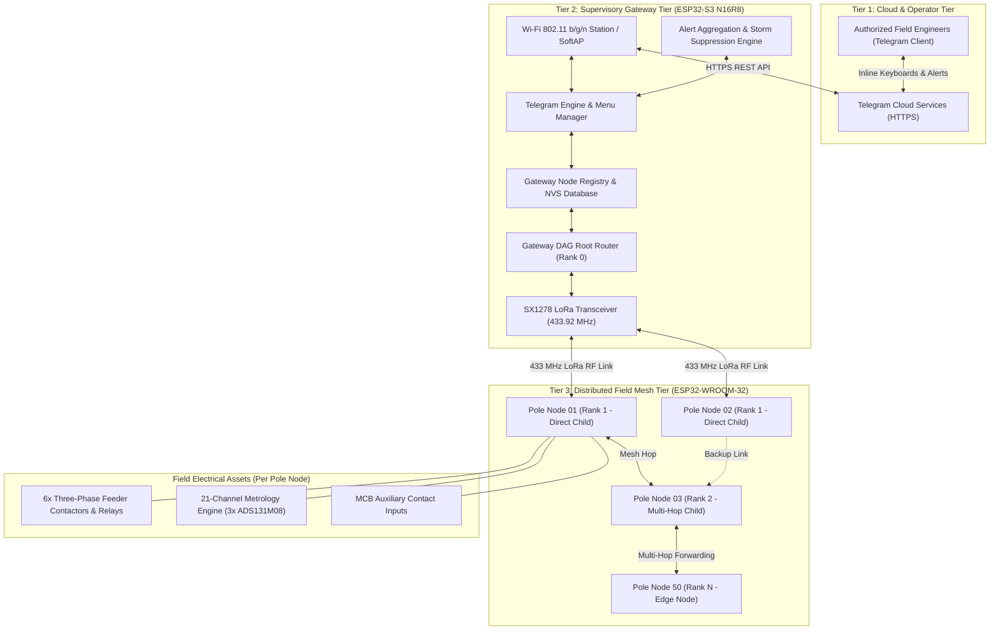
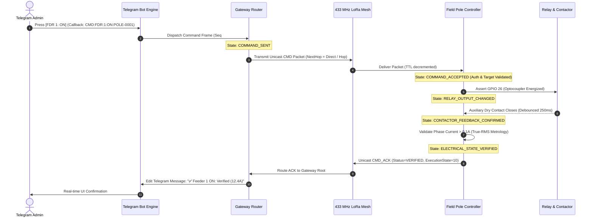
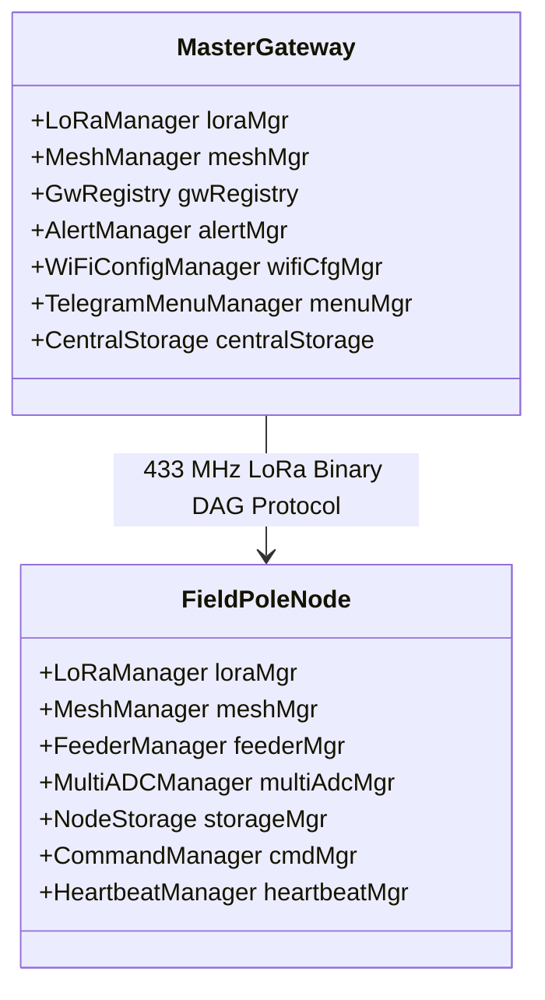

# 02 — MSCB Smart Pole Automation System: System Architecture

**Document ID**: MSCB-DOC-02  
**Classification**: Software & System Architecture  
**Firmware Baseline**: Gateway `GW_V10` / Field Pole `POLE_V10`  
**Date**: November 2026  
**Status**: Authoritative Handover Documentation  

---

## 1. Multi-Tier System Hierarchy

The MSCB Smart Pole Automation System follows a strictly decoupled, hierarchical three-tier architecture designed for resilience in harsh electrical and RF environments:

---

## 2. LoRa Mesh Topology: Gateway-Rooted Directed Acyclic Graph (DAG)

The RF communication layer is organized as a loop-free, Gateway-rooted Directed Acyclic Graph (DAG):
1. **Root Node**: The Master Gateway possesses fixed **Rank 0** (`ROOT_RANK = 0`).
2. **Hop Rank Formulation**: A node's Rank $R_i$ is strictly derived from its selected Primary Parent $P_1$:
   $$R_i = R_{P_1} + 1$$
   Any node that has no valid route to the Gateway takes Rank 255 (`INFINITY_RANK = 255`, Orphan State).
3. **Dual-Parent Selection**:
   - **Primary Parent ($P_1$)**: Candidate neighbor with the lowest cumulative Path Cost to Root.
   - **Backup Parent ($P_2$)**: Candidate neighbor with the lowest Path Cost whose upstream parent is different from $P_1$ (enforcing path diversity).
4. **Loop Suppression Rules**:
   - A node rejects any routing advertisement where the candidate's reported parent is the node itself.
   - A node rejects any candidate with a Rank $\ge$ its own current Rank.
   - A candidate reporting Rank 255 is strictly excluded from parent election.

---

## 3. End-to-End Data, Control & State Flows

### 3.1 Control Command Flow (Downstream: Telegram to Feeder Coil)

Control operations originate from authenticated Telegram administrators. To guarantee deterministic field execution, every control action traverses five distinct verification states:

### 3.2 Telemetry & Health Monitoring Flow (Upstream: Sensors to Gateway)
- **High-Rate Local DSP**: The Field Pole's three ADS131M08 ADCs continuously sample 21 analog channels at 4 kSPS per channel. Local True-RMS accumulation occurs every 20 ms (50 Hz cycle).
- **Scheduled Telemetry Frame**: Every 15–30 seconds, the pole encodes an 83-byte binary telemetry frame containing:
  - 3 Phase Voltages ($V_R, V_Y, V_B$).
  - 18 Feeder Phase Currents ($I_{F1\_R} \dots I_{F6\_B}$).
  - MCB Auxiliary Trip Bits (6 bits).
  - Contactor Auxiliary Feedback Bits (6 bits).
  - Node Health, Free Heap, Active Route, RSSI, and SNR.
- **Priority Mesh Queuing**: If an overcurrent, undervoltage, or MCB trip occurs, an immediate high-priority alert (`PRIO_HIGH`) preempts the queue and is dispatched over LoRa with exponential retransmission.

---

## 4. Key Architectural Subsystems & Separation of Concerns

### 4.1 Master Gateway Subsystems
1. **Cooperative Non-Blocking Scheduler**: `Sender.ino` runs a deterministic cooperative loop using `millis()` timestamps. No FreeRTOS task or driver call is permitted to execute blocking `delay()` operations during normal operations.
2. **Central Node Database (`GwRegistry.cpp`)**: Manages up to 50 active pole records, logical ID assignments (`POLE-0001` through `POLE-0050`), primary/backup parent associations, and last-seen timestamps.
3. **Alert Storm Suppression Engine (`AlertManager.cpp`)**: When an upstream feeder or grid transformer trips, multiple downstream poles report undervoltage simultaneously. The engine aggregates incidents within a 10-second sliding window (`AGGREGATION_WINDOW_MS = 10000`) and dispatches a single composite incident to Telegram, preventing bot rate-limiting.
4. **Persistent NVS Journal (`CentralStorage.cpp`)**: Persists node records, configuration thresholds, and revocation entries in ESP32 Non-Volatile Storage (NVS) with CRC32 integrity validation.

### 4.2 Field Pole Subsystems
1. **Relay Interlocking & Actuator Engine (`FeederManager.cpp`, `PoleActuators.cpp`)**:
   - Manages physical drive to 6 optocoupler outputs.
   - Enforces 500 ms staggering during group or all-feeder switching to eliminate transformer inrush tripping.
   - Monitors MCB auxiliary contacts with 5-sample (250 ms) digital software debouncing.
2. **Multi-ADC Metrology Engine (`MultiADCManager.cpp`)**:
   - Interfaces 3x ADS131M08 chips across a shared SPI bus using dedicated chip selects (`GPIO 13, 22, 21`).
   - Asserts common hardware `/SYNC` (`GPIO 33`) to ensure simultaneous zero-crossing alignment.
   - Computes True-RMS voltage, True-RMS current, active power, and power factor.
3. **Local Route Manager (`MeshManager.cpp`)**:
   - Maintains a 12-entry neighbor table (`MAX_NEIGHBORS = 12`) and a 30-entry routing table.
   - Monitors parent heartbeat beacons; automatically switches to the Backup Parent if 3 consecutive packets are unacknowledged.
