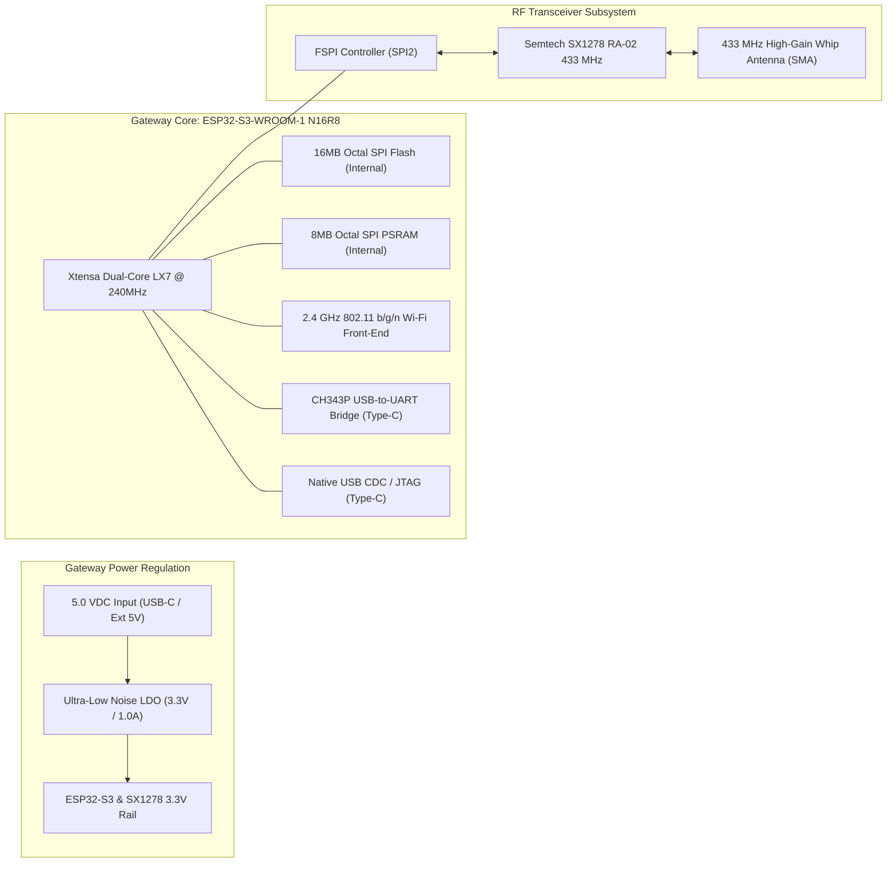

# 03 — MSCB Smart Pole Automation System: Hardware Architecture & Pin Mapping

**Document ID**: MSCB-DOC-03  
**Classification**: Electrical Engineering & Hardware Specification  
**System Code**: MSCB_SmartPole_System_R1  
**Date**: November 2026  
**Status**: Authoritative Handover Documentation  

> [!CAUTION]
> **HIGH-VOLTAGE MAINS ELECTRICAL SAFETY WARNING**:
> The MSCB Smart Pole System interacts with 3-Phase 415 VAC / 230 VAC 50 Hz power distribution feeders. Lethal voltages are present in physical enclosures. All high-voltage connections, contactor installations, CT wiring, and surge protection assemblies MUST be reviewed, installed, and certified by a qualified, licensed electrical engineer in compliance with National Electrical Code (NEC) / Central Electricity Authority (CEA) regulations before applying mains power. Do NOT energize unverified physical circuits.

---

## 1. Master Gateway Controller Hardware Architecture (ESP32-S3 N16R8)

The Gateway acts as the central communications hub between the 433 MHz LoRa mesh and the Telegram cloud service over Wi-Fi.

### 1.1 Gateway Hardware Block Diagram



### 1.2 Authoritative Gateway Pin Mapping (ESP32-S3 N16R8)

| Pin Name | GPIO | Direction | Peripheral Type | Boot Role | Status | Hardware Connected |
| :--- | :---: | :---: | :--- | :--- | :---: | :--- |
| `LORA_SCK` | **12** | OUTPUT | FSPI Clock (SPI2) | Normal | **VERIFIED SAFE** | SX1278 LoRa SCK |
| `LORA_MISO`| **13** | INPUT | FSPI MISO (SPI2) | Normal | **VERIFIED SAFE** | SX1278 LoRa MISO |
| `LORA_MOSI`| **11** | OUTPUT | FSPI MOSI (SPI2) | Normal | **VERIFIED SAFE** | SX1278 LoRa MOSI |
| `LORA_NSS` | **10** | OUTPUT | FSPI CS0 (SPI2) | Normal | **VERIFIED SAFE** | SX1278 LoRa Chip Select (Active LOW) |
| `LORA_RST` | **14** | OUTPUT | General GPIO | Normal | **VERIFIED SAFE** | SX1278 Hardware Reset (Active LOW) |
| `LORA_DIO0`| **2** | INPUT | External IRQ | Normal (S3) | **VERIFIED SAFE** | SX1278 Packet Ready Interrupt |
| `STATUS_LED`| **21** | OUTPUT | General GPIO | Normal | **VERIFIED SAFE** | Gateway Diagnostic Heartbeat LED |
| `WS2812_RGB`| **48** | OUTPUT | RMT Transceiver | Normal | **VERIFIED SAFE** | Onboard Addressable RGB Indicator |
| `USB_DM` | **19** | BIDI | Native USB D- | USB PHY | **RESERVED** | Type-C Native Port |
| `USB_DP` | **20** | BIDI | Native USB D+ | USB PHY | **RESERVED** | Type-C Native Port |
| `UART0_TX` | **43** | OUTPUT | UART0 TXD | Boot Print | **RESERVED** | CH343P UART Port 2 |
| `UART0_RX` | **44** | INPUT | UART0 RXD | Firmware Flash | **RESERVED** | CH343P UART Port 2 |
| `BOOT_KEY` | **0** | INPUT | Strapping | Download Mode | **RESTRICTED** | Onboard Boot Button (Pullup to 3.3V) |
| `VDD_SPI` | **45** | - | Strapping | Flash Voltage | **RESTRICTED** | Must remain LOW (Internal pull-down) |
| `ROM_LOG` | **46** | - | Strapping | ROM Log Control | **RESTRICTED** | Must remain LOW at boot |
| **OCTAL BUS**| **26–37**| - | **OCTAL FLASH/PSRAM**| **MEMORY BUS** | **FORBIDDEN** | **Internally Bonded to Flash/PSRAM!** |

> [!WARNING]
> **ESP32-S3 OCTAL PSRAM/FLASH HAZARD**:
> In the N16R8 package, GPIOs 26 through 32 are internally bonded to the 16MB Flash memory, and GPIOs 33 through 37 are internally bonded to the 8MB Octal PSRAM. **Never assign any GPIO between 26 and 37 in Gateway firmware!** Any access will cause an immediate hard memory fault or Kernel Panic (`Guru Meditation Error: Cache disabled but memory accessed`).

---

## 2. Secondary Field Pole Controller Hardware Architecture (ESP32 Classic)

Each Field Pole Node executes local metrology across 21 channels, controls 6 independent feeder contactors, supervises MCB trips, and maintains mesh connectivity.

### 2.1 Field Pole Hardware Block Diagram

```mermaid
flowchart TD
    subgraph PowerRail["Isolated Power Distribution"]
        MAINS["230 VAC Single-Phase Auxiliary Rail"] --> SMPS1["Isolated SMPS 1: 5.0V Logic (1.5A)"]
        MAINS --> SMPS2["Isolated SMPS 2: 5.0V Relay Coils (2.5A)"]
        SMPS1 --> LDO33["AMS1117-3.3 Regulated Logic Rail"]
        LDO33 --> ESP32RAIL["ESP32 & Transceiver 3.3V Logic Rail"]
        SMPS2 --> RELAYCOIL["Relay Coil JD-VCC Rail (Separate GND)"]
    end

    subgraph ESP32Controller["Field Pole Controller: ESP32-WROOM-32"]
        CPU["Xtensa Dual-Core LX6 @ 240MHz"]
        VSPI["VSPI Controller (SPI3)"]
        GPIOOUT["Safe Digital Outputs"]
        GPIIN["Input-Only GPI Pins"]
    end

    subgraph RFSubsystem["LoRa Mesh Subsystem"]
        SX1278["SX1278 433 MHz LoRa Module"]
        VSPI <-->|SCK:18, MISO:19, MOSI:23, CS:5| SX1278
        SX1278 -->|DIO0: GPIO 4| CPU
    end

    subgraph MetrologySubsystem["21-Channel Metrology Subsystem"]
        ADC1["ADS131M08 #1 (Feeder 1-3 Currents)"]
        ADC2["ADS131M08 #2 (Feeder 4-6 Currents)"]
        ADC3["ADS131M08 #3 (3-Phase Bus Voltages)"]
        
        VSPI <-->|Shared SPI Bus| ADC1
        VSPI <-->|Shared SPI Bus| ADC2
        VSPI <-->|Shared SPI Bus| ADC3
        
        GPIOOUT -->|CS1: GPIO 13| ADC1
        GPIOOUT -->|CS2: GPIO 22| ADC2
        GPIOOUT -->|CS3: GPIO 21| ADC3
        GPIOOUT -->|Common /SYNC: GPIO 33| ADC1 & ADC2 & ADC3
        
        ADC1 -->|/DRDY: GPIO 34| GPIIN
        ADC2 -->|/DRDY: GPIO 35| GPIIN
        ADC3 -->|/DRDY: GPIO 36| GPIIN
    end

    subgraph ActuatorSubsystem["Relay & Contactor Actuation Subsystem"]
        OPTO["6-Channel Optocoupler Isolation Board"]
        RELAYS["6x 3-Pole 25A Power Contactors"]
        MCBAUX["MCB Auxiliary Contact Detection"]
        
        GPIOOUT -->|Relays F1-F6: GPIO 26,25,27,16,17,32| OPTO
        OPTO --> RELAYS
        MCBAUX -->|MCB Feedback: GPIO 4,16,17,21,22| CPU
    end
```



### 2.2 Authoritative Field Pole Pin Mapping (ESP32-WROOM-32)

| Pin Name | GPIO | Direction | Function / Peripheral | Strapping / Reset Role | Status | Hardware Connected |
| :--- | :---: | :---: | :--- | :--- | :---: | :--- |
| `LORA_SCK` | **18** | OUTPUT | VSPI Clock | Normal | **VERIFIED SAFE** | SX1278 LoRa SCK |
| `LORA_MISO`| **19** | INPUT | VSPI MISO | Normal | **VERIFIED SAFE** | SX1278 LoRa MISO |
| `LORA_MOSI`| **23** | OUTPUT | VSPI MOSI | Normal | **VERIFIED SAFE** | SX1278 LoRa MOSI |
| `LORA_NSS` | **5** | OUTPUT | VSPI CS0 | Clock pulse @ reset | **VERIFIED SAFE** | SX1278 CS (Requires external 10k pull-up) |
| `LORA_RST` | **14** | OUTPUT | General GPIO | Normal | **VERIFIED SAFE** | SX1278 Hardware Reset |
| `LORA_DIO0`| **4** | INPUT | External IRQ | Safe General Input | **VERIFIED SAFE** | SX1278 Packet Ready Interrupt |
| `RELAY_F1` | **26** | OUTPUT | DAC2 / RTC_IO7 | Safe Output | **VERIFIED SAFE** | Feeder 1 Contactor Driver |
| `RELAY_F2` | **25** | OUTPUT | DAC1 / RTC_IO6 | Safe Output | **VERIFIED SAFE** | Feeder 2 Contactor Driver |
| `RELAY_F3` | **27** | OUTPUT | General GPIO | Safe Output | **VERIFIED SAFE** | Feeder 3 Contactor Driver |
| `RELAY_F4` | **16** | OUTPUT | UART2 RX / GPIO | Safe Output | **VERIFIED SAFE** | Feeder 4 Contactor Driver (Replaced GPIO 12) |
| `RELAY_F5` | **17** | OUTPUT | UART2 TX / GPIO | Safe Output | **VERIFIED SAFE** | Feeder 5 Contactor Driver (Replaced GPIO 15) |
| `RELAY_F6` | **32** | OUTPUT | RTC_IO9 | Safe Output | **VERIFIED SAFE** | Feeder 6 Contactor Driver |
| `ADC1_CS` | **13** | OUTPUT | General GPIO | Safe Output | **VERIFIED SAFE** | ADS131M08 #1 Chip Select (Active LOW) |
| `ADC2_CS` | **22** | OUTPUT | I2C SCL / GPIO | Safe Output | **VERIFIED SAFE** | ADS131M08 #2 Chip Select (Active LOW) |
| `ADC3_CS` | **21** | OUTPUT | I2C SDA / GPIO | Safe Output | **VERIFIED SAFE** | ADS131M08 #3 Chip Select (Active LOW) |
| `ADC_SYNC` | **33** | OUTPUT | General GPIO | Safe Output | **VERIFIED SAFE** | Common ADS131M08 Hardware /SYNC Pulse |
| `ADC1_DRDY`| **34** | INPUT | Input-Only (GPI) | No internal pull-up | **VERIFIED SAFE** | ADS131M08 #1 Data Ready (/DRDY) |
| `ADC2_DRDY`| **35** | INPUT | Input-Only (GPI) | No internal pull-up | **VERIFIED SAFE** | ADS131M08 #2 Data Ready (/DRDY) |
| `ADC3_DRDY`| **36** | INPUT | Sensor_VP (GPI) | No internal pull-up | **VERIFIED SAFE** | ADS131M08 #3 Data Ready (/DRDY) |
| `STATUS_LED`| **2** | OUTPUT | Strapping Pin | Download mode pin | **RESTRICTED** | Onboard Blue Diagnostic LED |
| **FLASH BUS**| **6–11**| - | **SPI FLASH BUS** | **Dedicated Flash** | **FORBIDDEN** | **Internally Bonded to Flash Memory!** |

---

## 3. Critical Silicon Traps & Resolved Engineering Flaws

In early legacy prototype code (`PS/Sender` and `PS/Resivers`), severe silicon strapping and voltage incompatibility hazards were uncovered:

```
┌─────────────────────────────────────────────────────────────────────────────┐
│                       CRITICAL SILICON RESOLUTION MATRIX                    │
├─────────────────┬─────────────────┬─────────────────────┬───────────────────┤
│ Pin Assignment  │ Legacy Behavior │ Silicon Consequence │ Resolved System_R1│
├─────────────────┼─────────────────┼─────────────────────┼───────────────────┤
│ Feeder 4 Relay  │ GPIO 12 (MTDI)  │ Optocoupler pulled  │ Relocated to      │
│                 │                 │ GPIO 12 HIGH at     │ GPIO 16           │
│                 │                 │ boot -> LDO forced  │ (Safe normal GPIO)│
│                 │                 │ to 1.8V -> SPI Flash│                   │
│                 │                 │ Read Brownout Loop! │                   │
├─────────────────┼─────────────────┼─────────────────────┼───────────────────┤
│ Feeder 5 Relay  │ GPIO 15 (MTDO)  │ Outputs 115200 baud │ Relocated to      │
│                 │                 │ ROM debug pulses @  │ GPIO 17           │
│                 │                 │ power-up -> Relay   │ (Safe normal GPIO)│
│                 │                 │ chattered on boot!  │                   │
├─────────────────┼─────────────────┼─────────────────────┼───────────────────┤
│ LoRa DIO0 IRQ   │ GPIO 2          │ Conflicted with     │ Relocated to      │
│                 │                 │ boot download pin & │ GPIO 4            │
│                 │                 │ onboard LED.        │ (Safe interrupt)  │
├─────────────────┼─────────────────┼─────────────────────┼───────────────────┤
│ ADC Data Ready  │ Bidirectional   │ Depleted GPIOs      │ Reassigned to     │
│ Interrupts      │ GPIOs           │ needed for relays.  │ Input-Only Pins   │
│                 │                 │                     │ GPIO 34, 35, 36.  │
└─────────────────┴─────────────────┴─────────────────────┴───────────────────┘
```

---

## 4. Subsystem Interfacing Schematics

### 4.1 SX1278 LoRa RA-02 SPI Wiring Diagram

```
      ESP32-S3 (Gateway)                          SX1278 RA-02 (433 MHz)
   ┌──────────────────────┐                      ┌──────────────────────┐
   │ GPIO 12 (FSPI SCK)   ├─────────────────────►│ SCK                  │
   │ GPIO 13 (FSPI MISO)  │◄─────────────────────┤ MISO                 │
   │ GPIO 11 (FSPI MOSI)  ├─────────────────────►│ MOSI                 │
   │ GPIO 10 (FSPI CS0)   ├─────────────────────►│ NSS (/CS)            │
   │ GPIO 14 (RST)        ├─────────────────────►│ RESET                │
   │ GPIO 2  (DIO0)       │◄─────────────────────┤ DIO0                 │
   │ 3.3V Power Rail      ├─────────────────────►│ VCC (3.3V, 120mA pk) │
   │ GND Rail             ├─────────────────────►│ GND                  │
   └──────────────────────┘                      └──────────────────────┘

      ESP32-WROOM-32 (Pole)                       SX1278 RA-02 (433 MHz)
   ┌──────────────────────┐                      ┌──────────────────────┐
   │ GPIO 18 (VSPI SCK)   ├─────────────────────►│ SCK                  │
   │ GPIO 19 (VSPI MISO)  │◄─────────────────────┤ MISO                 │
   │ GPIO 23 (VSPI MOSI)  ├─────────────────────►│ MOSI                 │
   │ GPIO 5  (VSPI CS0)   ├──────┬──────────────►│ NSS (/CS)            │
   │                      │     [10k Pull-up]    │                      │
   │                      │      └──► +3.3V      │                      │
   │ GPIO 14 (RST)        ├─────────────────────►│ RESET                │
   │ GPIO 4  (DIO0)       │◄─────────────────────┤ DIO0                 │
   │ 3.3V Power Rail      ├─────────────────────►│ VCC (3.3V, 120mA pk) │
   │ GND Rail             ├─────────────────────►│ GND                  │
   └──────────────────────┘                      └──────────────────────┘
```

### 4.2 Multi-ADC Interface Diagram (3x ADS131M08 via Shared SPI)

```
                       ESP32-WROOM-32 (Field Pole Controller)
      ┌─────────────────────────────────────────────────────────────────┐
      │  GPIO 18 (SCK) ──┬──────────────┬──────────────┬───────────────┐│
      │  GPIO 19 (MISO)─┼──────────────┼──────────────┼───────────────┼│
      │  GPIO 23 (MOSI)─┼──────────────┼──────────────┼───────────────┼│
      │  GPIO 13 (CS1)  │              │              │               ││
      │  GPIO 22 (CS2)  │              │              │               ││
      │  GPIO 21 (CS3)  │              │              │               ││
      │  GPIO 33 (SYNC)─┼──────────────┼──────────────┼───────────────┼│
      │  GPIO 34 (DRDY1)│              │              │               ││
      │  GPIO 35 (DRDY2)│              │              │               ││
      │  GPIO 36 (DRDY3)│              │              │               ││
      └────────┬────────┼──────────────┼──────────────┼───────────────┼┘
               │        │              │              │               │
               ▼        ▼              ▼              ▼               ▼
        ┌─────────────┐         ┌─────────────┐        ┌─────────────┐
        │ADS131M08 #1 │         │ADS131M08 #2 │        │ADS131M08 #3 │
        ├─────────────┤         ├─────────────┤        ├─────────────┤
        │CS    ◄──G13 │         │CS    ◄──G22 │        │CS    ◄──G21 │
        │SCK   ◄──G18 │         │SCK   ◄──G18 │        │SCK   ◄──G18 │
        │MISO  ──►G19 │         │MISO  ──►G19 │        │MISO  ──►G19 │
        │MOSI  ◄──G23 │         │MOSI  ◄──G23 │        │MOSI  ◄──G23 │
        │/SYNC ◄──G33 │         │/SYNC ◄──G33 │        │/SYNC ◄──G33 │
        │/DRDY ──►G34 │         │/DRDY ──►G35 │        │/DRDY ──►G36 │
        ├─────────────┤         ├─────────────┤        ├─────────────┤
        │Ch 0: F1-R I │         │Ch 0: F3-B I │        │Ch 0: F6-R I │
        │Ch 1: F1-Y I │         │Ch 1: F4-R I │        │Ch 1: F6-Y I │
        │Ch 2: F1-B I │         │Ch 2: F4-Y I │        │Ch 2: F6-B I │
        │Ch 3: F2-R I │         │Ch 3: F4-B I │        │Ch 3: Bus R V│
        │Ch 4: F2-Y I │         │Ch 4: F5-R I │        │Ch 4: Bus Y V│
        │Ch 5: F2-B I │         │Ch 5: F5-Y I │        │Ch 5: Bus B V│
        │Ch 6: F3-R I │         │Ch 6: F5-B I │        │Ch 6: Spare  │
        │Ch 7: F3-Y I │         │Ch 7: Spare  │        │Ch 7: Spare  │
        └─────────────┘         └─────────────┘        └─────────────┘
```

### 4.3 Current Sensor Interface Diagram (Split-Core CT Signal Conditioning)

```
   Feeder Conductor (Phase R/Y/B)
         ═══════════════════════════════╦══════════════════════════════
                                      ┌─╨─┐
                                      │CT │ Current Transformer (1000:1)
                                      └─╥─┘ Secondary: 0-25mA AC
                                        │
                         ┌──────────────┴──────────────┐
                         │                             │
                        ┌┴┐ R_Burden                  ┌┴┐ C_Filter
                        │ │ 12 Ω (0.1% 25ppm)         │ │ 10 nF (Anti-aliasing)
                        └┬┘                           └┬┘
                         ├─────────────────────────────┤
                         │                             │
                         ▼                             ▼
                 ADS131M08 AINxP               ADS131M08 AINxN
                 (True Differential Input ±1.2V Peak Full Scale)
```

### 4.4 Bus Voltage Sensor Interface Diagram (ZMPT101B Isolation Transformer)

```
   Mains 230 VAC Phase Bus
   ───────────────────────┬───────────────────────────────
                         ┌┴┐ R_Limit
                         │ │ 120 kΩ (2W High Voltage Metal Film)
                         └┬┘
                          ├──► ZMPT101B Primary (2mA Nominal)
                          │    Galvanic Isolation Barrier (4000V Breakdown)
                          ├──► Neutral Busbar
                          │
                   ZMPT101B Secondary Output
                          │
                         ┌┴┐ R_Burden
                         │ │ 300 Ω (0.1% Precision)
                         └┬┘
                          ├────────► Low-Pass RC Filter (fc = 1.6 kHz)
                          │          R = 1 kΩ, C = 100 nF
                          │
                          ▼
                   ADS131M08 AINxP / AINxN
```

### 4.5 Optocoupler-Isolated Relay Driver & Contactor Interface Diagram

```
   ESP32-WROOM-32              PC817 Optocoupler Board         Power Contactor & Coil
  ┌──────────────┐            ┌──────────────────────┐        ┌──────────────────────┐
  │ GPIO 26 (F1) ├───────────►│ IN1 (Active LOW)     │        │                      │
  │              │            │  │                   │        │                      │
  │ +3.3V Logic  ├───────────►│ VCC (Anode Supply)   │        │                      │
  │              │            │                      │        │                      │
  │ Logic GND    │ [ISOLATED] │ JD-VCC (External 5V) │───────►│ Relay Coil Terminal  │
  └──────────────┘            │ Relay Driver Trans.  │        │ (1N4007 Flyback)     │
                              │ Coil Ground (GND2)   │◄───────┤                      │
                              └──────────────────────┘        ├──────────────────────┤
                                                              │ 3-Pole 415V Contacts │
                                                              │ L1, L2, L3 Switched  │
                                                              ├──────────────────────┤
                                                              │ NO Auxiliary Contact │
                                                              │ (Contactor Feedback) │
                                                              └──────────┬───────────┘
                                                                         │
                                                                         ▼
                                                              ESP32 Feedback Input
                                                              (Debounced 250ms)
```

---

## 5. Comprehensive Hardware Verification Status

| Subsystem Component | Model / Part Number | Hardware Role | Engineering Classification | Action Required |
| :--- | :--- | :--- | :--- | :--- |
| **Gateway MCU Board** | DOIT ESP32-S3 Dual Type-C | Central Mesh Gateway | **VERIFIED SAFE** | In use (N16R8 verified) |
| **Field Pole MCU Board** | ESP32-WROOM-32 (30/38 Pin) | Field Pole Controller | **VERIFIED SAFE** | In use (Safe pins enforced) |
| **LoRa RF Transceiver** | Ai-Thinker RA-02 (SX1278) | 433 MHz RF Front-End | **VERIFIED SAFE** | 10k pull-up required on GPIO 5 |
| **RF Antenna** | 433 MHz 1/4-Wave Whip / Collinear | Sub-GHz RF Radiation | **VERIFIED SAFE** | Outdoor enclosure SMA lead |
| **Multi-Channel ADC** | TI ADS131M08 (3 units/pole) | 24-bit $\Delta\Sigma$ Metrology | **PROPOSED / LAB BENCH** | Multi-chip PCB layout required |
| **Current Sensors** | SCT-013-000 / Precision 1000:1 CT | 18 Feeder Phase Currents | **PROPOSED / BENCH** | Requires external burden resistors |
| **Voltage Sensors** | ZMPT101B Active Module | 3-Phase Bus Voltage | **UNVERIFIED AT MAINS** | Must verify 3.3V clamping diodes |
| **Relay Driver Board** | 6-Channel Optocoupler Module | Contactor Pilot Switching | **VERIFIED SAFE** | JD-VCC jumper MUST be removed! |
| **Power Contactors** | 3-Pole 25A 230V Coil AC-3 | Feeder Phase Switching | **UNVERIFIED AT MAINS** | Requires professional electrical sign-off |
| **Auxiliary MCBs** | 3-Pole MCB with Aux Switch | Overcurrent & Trip Feedback | **PROPOSED** | Verify dry contact voltage |
| **Legacy ACS712** | Allegro ACS712-20A (5V) | Prototype Hall Sensor | **UNSAFE / REJECTED** | **REPLACE! 5V output destroys 3.3V ADC!** |
| **Mains Direct Divider**| Direct Resistor String | High-Voltage Sensing | **UNSAFE / REJECTED** | **FORBIDDEN! Violates isolation barrier!** |
