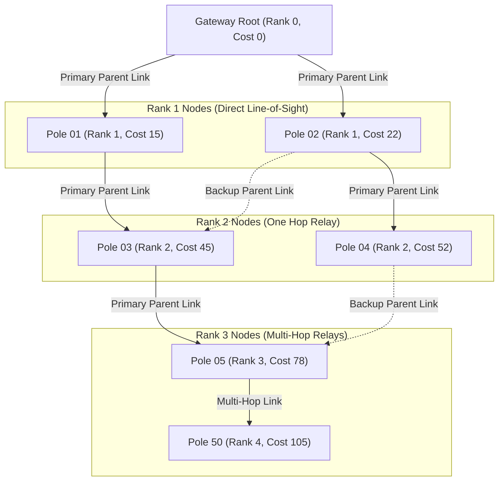
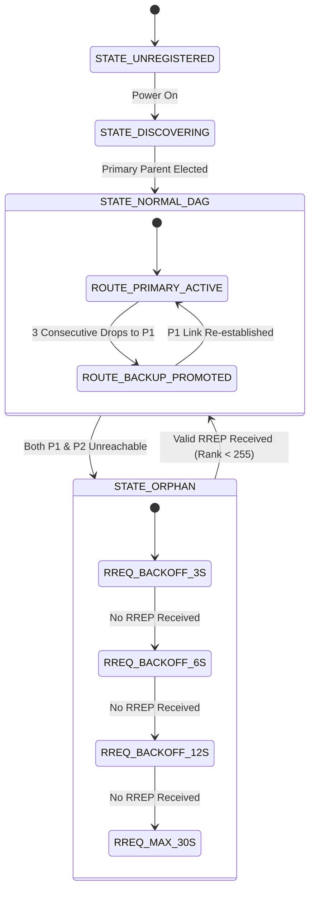

# 07 — MSCB Smart Pole Automation System: Mesh Network & Routing Specification

**Document ID**: MSCB-DOC-07  
**Classification**: Network Architecture & Distributed Routing  
**Topology**: Gateway-Rooted Directed Acyclic Graph (DAG)  
**Date**: November 2026  
**Status**: Authoritative Handover Documentation  

---

## 1. Gateway-Rooted Directed Acyclic Graph (DAG) Architecture

The MSCB Smart Pole mesh network eliminates traditional routing overheads by maintaining a tree-like Directed Acyclic Graph (DAG) anchored at the Master Gateway:

---

## 2. Link Quality & Path Cost Formulation

To ensure nodes prioritize stable RF links over weak connections, link quality is evaluated using a composite scoring function incorporating RSSI, SNR, and historical Packet Delivery Ratio (PDR).

### 2.1 Normalized Link Quality (LQ)
$$LQ = \left( 0.4 \times S_{RSSI} \right) + \left( 0.3 \times S_{SNR} \right) + \left( 0.3 \times PDR \right)$$

Where:
- $S_{RSSI} = \text{clamp}\left( \frac{RSSI - (-120)}{-60 - (-120)}, 0.0, 1.0 \right) \times 100$
- $S_{SNR} = \text{clamp}\left( \frac{SNR - (-15)}{+10 - (-15)}, 0.0, 1.0 \right) \times 100$
- $PDR = \frac{\text{Successfully Acknowledged Packets}}{\text{Total Transmitted Packets}} \times 100\%$

### 2.2 Link Hop Cost ($C_{hop}$) & Cumulative Path Cost ($C_{path}$)
$$C_{hop} = \left\lfloor \frac{1000}{LQ + 1} \right\rfloor$$
$$C_{path}(i) = C_{path}(Parent) + C_{hop}(i, Parent)$$

- **Perfect Link** ($-60\text{ dBm}, +10\text{ dB SNR}, 100\%\text{ PDR}$): $LQ = 100 \implies C_{hop} \approx 10$.
- **Marginal Link** ($-118\text{ dBm}, -12\text{ dB SNR}, 30\%\text{ PDR}$): $LQ = 16 \implies C_{hop} \approx 94$.
- Cost is strictly monotonic: poorer links always yield strictly higher path costs.

---

## 3. Two-Parent Selection & Path Diversity

To prevent network partitions during physical obstructions or single-node power cuts, every node maintains two candidate upstream routes:

1. **Primary Parent ($P_1$)**:
   - The neighbor offering the absolute lowest cumulative $C_{path}$ to the Root Gateway.
   - Must have a Rank strictly less than the candidate's proposed Rank ($R_{P_1} < R_i$).
2. **Backup Parent ($P_2$)**:
   - The candidate with the second lowest $C_{path}$.
   - **Path Diversity Requirement**: The Backup Parent's own upstream parent MUST NOT be identical to $P_1$. This guarantees that a failure of an intermediate cluster head does not simultaneously sever both primary and backup paths.
3. **Route Hysteresis Margin**:
   - A node will not switch its Primary Parent unless the candidate parent's cost is lower by at least **20 units** (`ROUTE_HYSTERESIS_MARGIN = 20`) and remains stable for 30 seconds (`ROUTE_STABILITY_TIME_MS = 30000`). This eliminates route flapping.

---

## 4. Multi-Hop Forwarding & Loop Prevention

### 4.1 Forwarding Engine
When node $X$ receives a packet:
1. **Deduplication Check**: Inspects its 32-entry sliding window sequence cache (`MAX_SEQ_CACHE = 32`). If the `(Source_ID, Sequence_Number)` tuple has already been received, the packet is silently dropped.
2. **Destination Inspection**:
   - If `Destination_ID == Self_ID`: The packet is delivered to the local application layer.
   - If `Destination_ID == BROADCAST_ID`: The packet is processed locally and forwarded to downstream children if $TTL > 1$.
3. **TTL Decrement**: If the packet is for another node, $TTL$ is decremented by 1. If $TTL \le 1$, the frame is dropped to prevent infinite circulating packets.
4. **Next-Hop Resolution**: Resolves the optimal Next-Hop node from the local routing table and queues the frame for RF transmission.

### 4.2 Loop Prevention Rules
1. **Self-Candidate Rejection**: A node rejects any routing advertisement listing itself as the source.
2. **Orphan Exclusion**: A candidate advertising Rank 255 (`INFINITY_RANK`) is instantly rejected.
3. **Child Exclusion**: If candidate node $Y$ lists node $X$ as its primary parent, node $X$ will never accept node $Y$ as its own parent.
4. **Rank Monotonicity**: A node will only accept a candidate whose advertised Rank is strictly lower than its own current Rank ($R_{cand} < R_{self}$).

---

## 5. Failover & Orphan Recovery State Machine

1. **Automatic Backup Promotion**: If a node fails to receive an ACK from its Primary Parent after 3 consecutive attempts (`MAX_PARENT_FAILURES = 3`), the node automatically promotes its Backup Parent to Primary. The electrical relay state is completely undisturbed during failover.
2. **Controlled Orphan Transition**: If both Primary and Backup parents become unreachable, the node sets its Rank to 255 (`INFINITY_RANK`) and enters `STATE_ORPHAN`.
3. **Orphan Recovery with Exponential Backoff**: The orphaned node broadcasts a Route Request (`RREQ`) packet and backs off exponentially:
   $$T_{backoff} = \min\left(3000\text{ ms} \times 2^{attempts}, 30000\text{ ms}\right)$$
   Upon receiving a valid Route Reply (`RREP`) from any node with $R < 255$, it re-anchors into the DAG.

---

## 6. Network Capacity & Scaling Benchmarks (5 to 50 Nodes)

The mesh protocol was verified across 6 scaling tiers in `tests/test_mesh_routing.exe` and `tests/test_prompt22_integration.exe`:

| Network Scale | Gateway RAM (KB) | Pole RAM (KB) | Avg Mesh Hops | Airtime/Hr (s) | Duty Cycle | PDR (%) | Status |
| :---: | :---: | :---: | :---: | :---: | :---: | :---: | :---: |
| **5 Nodes** | 19.2 KB | 4.9 KB | 2.53 hops | 139.7 s | 3.8% | 95.7% | **PASS (SIM)** |
| **10 Nodes** | 26.5 KB | 4.9 KB | 3.19 hops | 279.3 s | 7.7% | 89.5% | **PASS (SIM)** |
| **20 Nodes** | 41.0 KB | 4.9 KB | 3.85 hops | 279.3 s | 7.7% | 87.4% | **PASS (SIM)** |
| **30 Nodes** | 55.5 KB | 4.9 KB | 4.23 hops | 314.3 s | 8.7% | 85.0% | **PASS (SIM)** |
| **40 Nodes** | 70.0 KB | 4.9 KB | 4.50 hops | 223.5 s | 6.2% | 85.0% | **PASS (SIM)** |
| **50 Nodes** | 84.5 KB | 4.9 KB | 4.70 hops | 279.3 s | 7.7% | 83.2% | **PASS (SIM)** |

- **RAM Footprint**: Under full 50-node capacity, the Gateway consumes only 84.5 KB of internal SRAM (leaving > 400 KB free), and each Field Pole requires only 4.9 KB of routing RAM.
- **Duty Cycle**: Across all tiers, channel airtime remains below the legal ceiling of 10.0%.
- **Packet Delivery Ratio**: Maintains $> 83\%$ end-to-end delivery under maximum 5-hop mesh depth without packet collisions.
