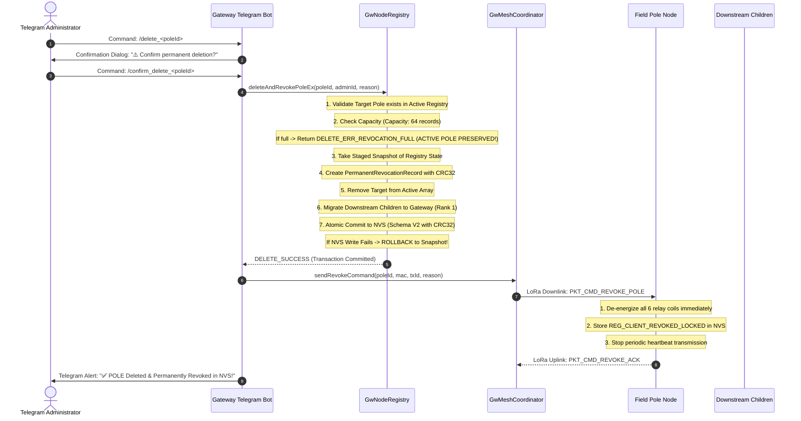

# 08 — MSCB Smart Pole Automation System: Dynamic Registration & Deletion Engine

**Document ID**: MSCB-DOC-08  
**Classification**: Device Lifecycle & Access Control  
**Firmware Baseline**: Gateway `GW_V10` / Field Pole `POLE_V10`  
**Date**: November 2026  
**Status**: Authoritative Handover Documentation  

---

## 1. Dynamic Node Registration Workflow

To eliminate hardcoded node lists and simplify field commissioning, new field poles undergo a dynamic zero-touch discovery and administrative authorization protocol:

```mermaid
sequenceDiagram
    autonumber
    participant Node as New Field Pole (ESP32)
    participant Parent as Neighbor Relay Node
    participant GW as Master Gateway (ESP32-S3)
    actor Admin as Telegram Administrator

    Note over Node: State: DISCOVERING (Relays Locked Inactive)
    Node->>Parent: Broadcast JOIN_REQ (Hardware MAC, Nonce, HMAC)
    Parent->>GW: Forward Multi-Hop JOIN_REQ (Link RSSI/SNR)
    Note over GW: Validate HMAC & Nonce; Check Blacklist
    GW->>Admin: Telegram Alert: "🆕 New Pole Detected! MAC: A4:CF:12:..."
    Note over Admin: Admin presses [Approve] button in Telegram
    Admin->>GW: Telegram Callback: REG_APPROVE:A4CF12...
    Note over GW: Assign Unique Logical ID: POLE-0005 & FDR-0025..0030
    GW->>Parent: Unicast JOIN_ACCEPT (Logical ID, Mesh Key, Feeder Mask)
    Parent->>Node: Deliver JOIN_ACCEPT
    Note over Node: Persist ID & Keys to NVS; Transition to ACTIVE
    Note over Node: Relays Unlocked; Telemetry Cadence Starts
    Node->>GW: Telemetry Beacon (Initial 21-Channel Readings)
    GW->>Admin: Telegram Confirmation: "✅ Pole POLE-0005 Active!"
```

---

## 2. Dynamic ID Allocation & Feeder Naming

When an administrator approves a node in Telegram, the Gateway executes automated logical ID generation:

1. **Pole Logical ID Generation**:
   - Sequential, zero-padded identifier: `POLE-0001` through `POLE-0050`.
   - Guaranteed collision-free across restarts via persistent NVS tracking.
2. **Feeder Identifier Allocation**:
   - Each pole is automatically provisioned with 6 logical feeders:
     $$\text{Feeder ID Base} = (Node\_Index - 1) \times 6 + 1$$
     $$\text{Feeder IDs} = \text{FDR-}(Base) \dots \text{FDR-}(Base + 5)$$
   - For example, `POLE-0002` receives `FDR-0007` through `FDR-0012`.
3. **Capacity Ceiling Enforcement**:
   - The Gateway strictly enforces a 50-node limit (`MAX_NODES = 50`).
   - If a 51st unprovisioned node attempts registration, the Gateway rejects the request with code `REG_ERR_CAPACITY_FULL` and alerts the administrator.

---

## 3. Node Deletion & Two-Phase Persistent Revocation Engine (R2 Release)

When a pole is decommissioned, physically damaged, or suspected of compromise, an administrator executes permanent deletion from Telegram. In the R2 firmware release, this engine operates as a strictly transactional, fail-safe Two-Phase Commit with full rollback protection:

### 3.1 Two-Phase Transactional Deletion Flow



### 3.2 Permanent Revocation Blacklist & Capacity Safeguards
1. **64-Record Revocation Capacity**:
   - `MSCB_MAX_REVOCATION_RECORDS` is set to **64**, exceeding the 50 active pole network capacity.
   - **Zero Silent Dropping**: The Gateway never silently evicts, overwrites, or purges existing revocations.
   - **Capacity Guard**: If the revocation list reaches capacity (64), subsequent deletion requests are rejected with `DELETE_ERR_REVOCATION_FULL`. The active pole is **NOT** deleted.
2. **Two-Phase Commit & Rollback**:
   - State changes are persisted to NVS namespace `mscb_reg` with Schema V2.
   - If any Preferences write (`putBytes`, `putUChar`, `putUInt`) fails, the active, revoked, and pending arrays immediately roll back to their pre-transaction snapshot.
3. **Child Route Migration**:
   - Downstream children with the deleted pole as `primaryParent` or `backupParent` are automatically re-routed to the Master Gateway (`MSCB_GATEWAY_NODE_ID`, Rank 1).
4. **Pending Queue Durability**:
   - Pending registration entries are committed to NVS (`mscb_reg`) with discovery metadata (MAC, RSSI, SNR, FW version, parent).
   - If the Gateway reboots while nodes are pending approval, the entire queue is restored upon restart.
5. **Telegram Queue Pagination**:
   - The Telegram interface displays pending devices in paginated pages with one-click `[✅ Approve]` and `[❌ Reject]` controls.

### 3.3 Revoked Pole Reappearance Detection & Re-Authorization
1. **Field Pole Persistent Revocation**:
   - The Field Pole stores `reg_st = REG_CLIENT_REVOKED_LOCKED` in NVS.
   - Upon reboot, it detects its revoked state, forces all relays to safe OFF (`HIGH`), and suppresses normal heartbeat transmission.
   - It transmits a dedicated `PKT_ALERT_REVOKED_REAPPEAR` packet to the Gateway.
2. **Gateway Security Alert**:
   - When the Gateway detects an unknown or revoked pole attempting a heartbeat or join request, it:
     - Rejects the packet with `HB_ACK_REVOKED_LOCKED` or `REG_RESP_REJECTED_REVOKED`.
     - Sets a high-priority security alert in `GwNodeRegistry`.
     - Broadcasts an immediate Telegram alert:
       ```
       🚨 SECURITY ALERT: REVOKED DEVICE REAPPEARED
       MAC: AA:BB:CC:11:22:01
       Previous ID: POLE-0002
       Status: PERMANENTLY REVOKED (Relays locked OFF)
       To re-authorize: /restore_AABBCC112201
       ```
   - The node is **never** automatically admitted into the active or pending queues.
3. **Explicit Administrative Re-Authorization**:
   - Admin sends `/restore_<MAC>` (e.g. `/restore_AABBCC112201`).
   - Bot displays warning and requests confirmation: `/confirm_restore_<MAC>`.
   - Gateway calls `unrevokePole()`, removes the MAC from NVS, and commits the updated registry.
   - The hardware is now eligible to register anew and will enter the standard `PENDING_APPROVAL` queue on its next broadcast.

### 3.4 Telegram Bot Revocation Commands Summary
| Command | Parameter | Permission | Function |
| :--- | :--- | :---: | :--- |
| `/delete_<id>` | Pole ID (e.g. `2`) | Admin Only | Initiates two-step deletion dialog |
| `/confirm_delete_<id>`| Pole ID (e.g. `2`) | Admin Only | Executes transactional deletion & revocation |
| `/revoked` | None | Admin Only | Lists all currently revoked hardware MACs and reasons |
| `/restore_<mac>` | 12 Hex Chars | Admin Only | Prompts for confirmation to un-revoke hardware MAC |
| `/confirm_restore_<mac>`| 12 Hex Chars | Admin Only | Re-authorizes hardware and clears blacklist in NVS |
