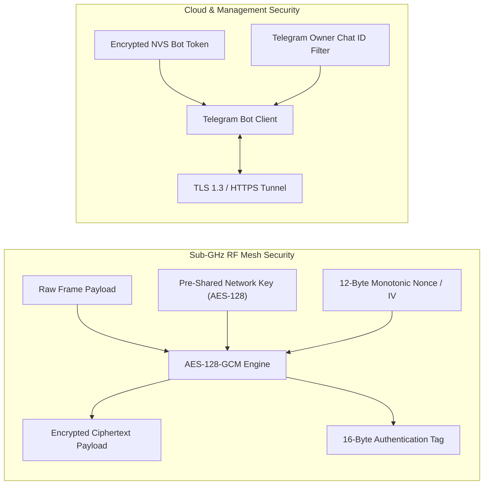

# 13 — MSCB Smart Pole Automation System: Security Architecture & Recovery Manual

**Document ID**: MSCB-DOC-13  
**Classification**: Cyber-Physical Security & Cryptographic Standard  
**Security Standard**: AES-128-GCM / HMAC-SHA256 Authenticated Encryption  
**Date**: November 2026  
**Status**: Authoritative Handover Documentation  

> [!IMPORTANT]
> **NO PRODUCTION SECRETS COMMITTED**:
> In accordance with strict embedded security policies, production cryptographic keys, Telegram bot tokens, and Wi-Fi credentials are NEVER committed in plaintext source code or technical documentation. All keys referenced herein are architectural descriptors; physical units are provisioned individually in secure NVS during field commissioning.

---

## 1. Cryptographic Protection Architecture

The MSCB Smart Pole System employs an Authenticated Encryption with Associated Data (AEAD) model across all RF and Cloud communication channels:

### 1.1 Over-The-Air Frame Encryption (AES-128-GCM)
- Every packet payload is encrypted using AES-128 in Galois/Counter Mode (GCM).
- **Initialization Vector (IV)**: A unique 12-byte nonce constructed from:
  $$\text{IV} = \text{Source\_ID (2B)} \parallel \text{Destination\_ID (2B)} \parallel \text{Sequence\_Number (4B)} \parallel \text{Timestamp (4B)}$$
- **Integrity Tag**: A 16-byte GCM authentication tag appended to every frame. Tampered packets fail tag verification and are discarded before reaching the application layer.

### 1.2 Anti-Replay Protection Engine
- Nodes maintain a sliding-window deduplication cache of the last 32 sequence numbers (`MAX_SEQ_CACHE = 32`).
- If an incoming frame contains a sequence number $\le$ the lowest cached sequence number or matching an active cached ID, the packet is silently dropped. This defends against RF packet capture-and-replay attacks.

---

## 2. Administrator Access Control & Key Management

### 2.1 Multi-Tier Administrative Roles
1. **Root Administrator**: Bound to the primary Telegram Chat ID (`OWNER_CHAT`). Can execute node deletions, Wi-Fi credential updates, and factory resets.
2. **Field Technician**: Can view telemetry, execute manual feeder switching, and perform local sensor calibration. Cannot delete nodes or alter encryption keys.

### 2.2 Device Key Provisioning Protocol
- At factory flashing, each ESP32 board is programmed with a unique hardware Master Key derived from its physical silicon MAC address using PBKDF2:
  $$\text{Device\_Key} = \text{PBKDF2}(\text{Silicon\_MAC}, \text{Salt}_{MSCB}, 10000, 16)$$
- During initial dynamic registration, the Gateway uses this pre-shared key to securely deliver the ephemeral Network Session Key (`MESH_NET_KEY`) inside the encrypted `JOIN_ACCEPT` payload.

---

## 3. Node Replacement & Decommissioning Security

### 3.1 Node Replacement Procedure (Failed Hardware)
If an existing physical pole controller is damaged by lightning or mechanical failure:
1. Decommission the damaged unit via Telegram: `/pole delete POLE-0005`. This issues a cryptographic revocation broadcast and blacklists the old hardware MAC.
2. Mount the replacement ESP32 controller.
3. Power on the replacement unit. The Gateway detects the new MAC address and prompts for registration.
4. In Telegram, approve the new hardware and assign the existing logical ID: `POLE-0005`.
5. The replacement unit seamlessly inherits the existing feeder assignments, calibration tables, and routing tree.

### 3.2 Secure Gateway & Pole Factory Reset
- **Gateway Reset**: Hold physical `BOOT_KEY` (`GPIO 0`) for $\ge 10$ seconds during boot. Firmware wipes all NVS namespaces (`meshdb`, `wifi`, `gwlog`, `revoc`) and re-initializes factory default settings.
- **Field Pole Reset**: Disconnect power, jumper `GPIO 32` to `GND`, and power cycle. Firmware wipes local NVS calibration and registration flags, returning the unit to `STATE_UNREGISTERED`.

---

## 4. Security Incident Response Matrix

| Incident Type | Diagnostic Indicator | Automatic Firmware Response | Administrator Action Required |
| :--- | :--- | :--- | :--- |
| **RF Replay Attack** | Rapid sequence counter errors in logs | Deduplication cache drops frames | Monitor RF spectrum; rotate network key if persistent |
| **Rogue Node Injection** | Unauthorized `JOIN_REQ` packets | Gateway drops packets (invalid HMAC)| Reject pending approval; inspect physical site |
| **Telegram Brute Force**| Unauthorized chat IDs attempting commands | Silent drop + access violation log | Verify bot privacy mode; rotate Bot Token |
| **Wi-Fi Hijacking** | Repeated connection dropouts | Gateway rolls back to stable SSID; activates SoftAP | Inspect router security; update WPA3 password |
| **Physical Tamper** | Sudden MCB trip + enclosure door open | Instant P0 Telegram Alert | Dispatch field inspection team |
