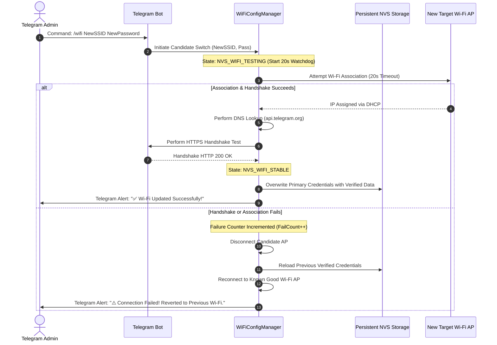

# 14 — MSCB Smart Pole Automation System: Wi-Fi Management & Configuration Engine

**Document ID**: MSCB-DOC-14  
**Classification**: Network Management & Remote Configuration  
**Firmware Baseline**: Gateway `GW_V10` / Field Pole `POLE_V10`  
**Date**: November 2026  
**Status**: Authoritative Handover Documentation  

---

## 1. Multi-Stage Non-Destructive Wi-Fi Transition Engine

In unattended rural installations, updating Wi-Fi credentials presents a severe operational hazard: if a typo occurs in the new SSID or password, the Gateway becomes permanently stranded without internet, requiring physical dispatch to the field.

To guarantee zero remote lockouts, `WiFiConfigManager.cpp` implements a **Five-Stage Non-Destructive Wi-Fi Verification Pipeline**:



---

## 2. Fallback Recovery Access Point (`MSCB-GW-RECOVERY`)

If the Gateway experiences **3 consecutive connection failures** (`WIFI_MAX_FAIL_BEFORE_AP = 3`) across all stored profiles (e.g. primary Wi-Fi router was permanently replaced):
1. The Gateway automatically enters **Dual Station / SoftAP Mode**.
2. It launches an unthrottled emergency Wi-Fi network:
   - **SSID**: `MSCB-GW-RECOVERY`
   - **IP Address**: `192.168.4.1`
   - **Status**: Captive Web Portal / Serial Recovery Active
3. A field technician can connect directly to this SoftAP with a smartphone or laptop, open `http://192.168.4.1`, and provision new credentials.
4. If no connection occurs within 10 minutes, the Gateway power cycles its RF and Wi-Fi peripherals to recover from transient lockups.

---

## 3. Emergency Serial CLI Recovery Commands

For emergency on-site maintenance over USB Type-C (115200 baud), `WiFiConfigManager` provides an interactive command-line interface (CLI):

| Command Syntax | Arguments | Purpose / Action |
| :--- | :--- | :--- |
| `STATUS` | None | Displays current Wi-Fi status, IP, RSSI, and LoRa queue size. |
| `SET_SSID <ssid>` | String (1-32 chars) | Stages new Wi-Fi SSID in volatile RAM. |
| `SET_PASS <pass>` | String (8-64 chars) | Stages new WPA2/WPA3 password in volatile RAM. |
| `CONNECT` | None | Triggers non-destructive connection verification. |
| `AP_MODE` | None | Forces immediate activation of `MSCB-GW-RECOVERY` SoftAP. |
| `REVERT` | None | Discards staged changes and restores last verified NVS profile. |
| `RESET_ALL` | Confirmation code | Factory wipes NVS configuration namespaces. |

---

## 4. Remote Parameter Distribution across LoRa Mesh

The Gateway acts as the master configuration authority for the 50 field poles. When an administrator adjusts operational thresholds in Telegram, `ConfigDistribution.cpp` broadcasts configuration frames over LoRa:

```
┌─────────────────────────────────────────────────────────────────────────────┐
│                       REMOTE CONFIGURATION PARAMETERS                       │
├───────────────────────────┬───────────────┬─────────────────────────────────┤
│ Parameter Name            │ Default Value │ Distribution Cadence            │
├───────────────────────────┼───────────────┼─────────────────────────────────┤
│ Overcurrent Trip Rating   │ 25.0 Amperes  │ Unicast / Group Update on change│
│ Overvoltage Limit         │ 260.0 VAC     │ Unicast / Group Update on change│
│ Undervoltage Limit        │ 180.0 VAC     │ Unicast / Group Update on change│
│ Beacon Interval           │ 30 seconds    │ Low-priority periodic broadcast │
│ Telemetry Reporting Rate  │ 15 seconds    │ Low-priority periodic broadcast │
│ Time Sync Epoch (UTC)     │ System Clock  │ Every 10 minutes broadcast      │
└───────────────────────────┴───────────────┴─────────────────────────────────┘
```
