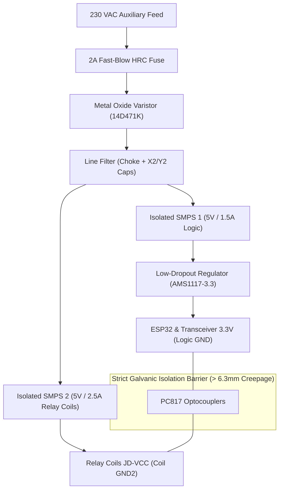

# 17 — MSCB Smart Pole Automation System: Physical Installation & Wiring Guide

**Document ID**: MSCB-DOC-17  
**Classification**: Field Mechanical & Electrical Engineering Manual  
**Operating Environment**: Outdoor Industrial Distribution Poles (IP65 / IP66)  
**Date**: November 2026  
**Status**: Authoritative Handover Documentation  

> [!CAUTION]
> **HIGH-VOLTAGE MAINS WIRING WARNING**:
> All connections to the 3-Phase 415 VAC / 230 VAC distribution network MUST be executed by certified, licensed electrical contractors adhering strictly to national safety codes. Disconnect all upstream distribution transformer fuses prior to physical cabinet wiring.

---

## 1. Cabinet & Enclosure Mechanical Requirements

Field Pole hardware operates exposed to severe outdoor environments (dust, monsoons, direct solar radiation, and lightning).

1. **Enclosure Rating**: Ingress Protection **IP65 or IP66** mandatory.
2. **Material**: UV-stabilized polycarbonate or powder-coated galvanized steel ($1.5\text{ mm}$ minimum thickness).
3. **Mounting Elevation**: Fixed at a minimum height of **3.5 meters** above ground level on the utility pole using stainless steel clamping brackets (Grade 304). This prevents vandalism, vehicular strikes, and flood inundation.
4. **Thermal Management**: Solar radiation shield / rain canopy with internal labyrinth breather vents to prevent condensation while maintaining ingress protection.

---

## 2. Antenna Installation & RF Surge Protection

RF performance in sub-GHz mesh networks depends heavily on antenna elevation and ground-plane isolation:

```
                      433 MHz Outdoor Whip / Collinear Antenna
                                      │
                                      ▼
                             ┌─────────────────┐
                             │ Pole Top Bracket│ (Erected at > 6 meters)
                             └────────┬────────┘
                                      │
                                  [RG-58 / LMR-195 Coaxial Cable]
                                  (Length < 2.0 meters, 0.5dB loss)
                                      │
                                      ▼
                             ┌─────────────────┐
                             │ Gas Tube Surge  ├───────► Heavy Copper Lead
                             │ Arrestor (SMA)  │         (4 mm² to Ground Rod)
                             └────────┬────────┘
                                      │
                                      ▼
                             Cabinet SX1278 Module
```

1. **Antenna Type**: Matched 433 MHz 1/4-wave whip with radial ground plane, or 3.5 dBi omnidirectional collinear antenna.
2. **Mounting Position**: Antenna must be mounted at the highest physical point of the pole, clear of adjacent high-voltage lines by at least **1.0 meter**.
3. **Lightning Protection**: Install an in-line SMA gas-discharge tube surge arrestor where the coaxial cable penetrates the cabinet. Earth the arrestor body directly to the pole earthing electrode.

---

## 3. Power Supply & Galvanic Isolation Architecture

Field electrical noise from switching contactors and line surges can easily latch up microcontrollers if supplies share ground loops:



- **JD-VCC Jumper Isolation**: On the 6-channel relay driver board, **the JD-VCC to VCC jumper MUST be physically removed**.
  - `VCC` connects to ESP32 3.3V (driving the optocoupler anodes).
  - `JD-VCC` connects to SMPS 2 (5V coil supply).
  - `GND` of the ESP32 must NEVER be connected to the relay coil return ground.

---

## 4. Power Contactor & Sensor Wiring Diagram

```
   Incoming 3-Phase 415 VAC Busbar
   ═══════════════════════════════════════════════════════════════════
        │                 │                 │
      ┌─┴─┐             ┌─┴─┐             ┌─┴─┐
      │F1 │             │F2 │             │F3 │ 3-Pole 32A MCB Breaker
      └─┬─┘             └─┬─┘             └─┬─┘
        │                 │                 │
   ─────┼─────────────────┼─────────────────┼─────────────────────────
        │                 │                 │
      ┌─┴─┐             ┌─┴─┐             ┌─┴─┐
      │CT1│             │CT2│             │CT3│ Split-Core CTs (1000:1)
      └─┬─┘             └─┬─┘             └─┬─┘ (Wired to ADS131M08)
        │                 │                 │
   ─────┼─────────────────┼─────────────────┼─────────────────────────
        │                 │                 │
     ┌──┴──┐           ┌──┴──┐           ┌──┴──┐
     │ L1  │           │ L2  │           │ L3  │ 3-Pole 25A Power Contactor
     └──┬──┘           └──┬──┘           └──┬──┘
        │                 │                 │
        ▼                 ▼                 ▼
   Outgoing Feeder Conductor to Street Lights / Agricultural Motors
```
