# MSCB SMART POLE SYSTEM — R3.2.1 CRITICAL FIXING & IMPLEMENTATION PLAN

**Document Version:** 1.0.0  
**Baseline Release:** R3.2 (`d6def238c7d56f5bcbf6963b4e6bd6a5584a72d2`)  
**Target Release:** R3.2.1 (`r3.2.1-critical-mesh-truth-repair`)  
**Target Architecture:** ESP32-S3 (Gateway) / ESP32-WROOM-32 (Field Pole)  
**Author / Role:** Senior Embedded Systems Engineer, ESP32/LoRa Mesh Architect, Security Auditor  
**Date:** November 2026  

---

## 1. Executive Overview & Scope

The purpose of Release **R3.2.1** is to resolve critical gaps identified in the source-level audit of R3.2. Rather than providing superficial test assertions or documentation-only claims, this release implements actual embedded logic, robust state machines, truth-preserving telemetry, and hardware safety locks in production C++ firmware.

### Strict Governance Rules
1. Never modify legacy `Sender/` and `Resivers/` directories.
2. Production relay safety lock `MSCB_RELAYS_LOCKED_DISABLED = 1` remains strictly active.
3. No connection or testing with 230V/415V mains. Low-voltage isolated bench DC only.
4. Active-low relay logic (`RELAY_ACTIVE_LOW = 1`) and physical pin mapping preserved.
5. Zero tolerance for tautological tests (no asserting hardcoded constants like `MAIN_MENU_BUTTONS = 6`). Every test must execute production classes and parse real data structures.
6. Real hardware limitations must be truthfully reported: features unverified on physical hardware must report `NOT TESTED` or `NOT IMPLEMENTED`.

---

## 2. Technical Gap Analysis & Implementation Plan

```mermaid
flowchart TD
    subgraph P0_Mesh["P0: Mesh & Child Tracking"]
        A1["Self-Loop Drop (src == myNodeId)"] --> A2["Monotonic Rank & Cycle Prevention"]
        A2 --> A3["Populate Tracked Children on Real Frames"]
        A3 --> A4["Child Timeout & Gateway Status Alert"]
    end

    subgraph P0_Gateway["P0: Gateway Heartbeat & Cascade Alerts"]
        B1["Explicit States (ONLINE, SUSPECTED, OFFLINE, UNREACHABLE_VIA_PARENT, UNKNOWN)"] --> B2["Real Cascade Detection from Parent Map"]
        B2 --> B3["Bounded Alert Event Queue (Replace Single Buffer)"]
        B3 --> B4["Per-Node Alert Cooldown & Deduplication"]
    end

    subgraph P0_Telegram["P0: Telegram UI Ergonomics"]
        C1["Strict Max 6 Buttons Per Menu"] --> C2["Paginate Feeder Lists (4+2 Buttons)"]
        C2 --> C3["Actual JSON Menu Structure Parser Tests"]
    end

    subgraph P0_Safety["P0: Feedback & Physical Safety"]
        D1["Missing Feedback != Healthy/Open (Explicit State)"] --> D2["Physical Authorization Pin & Timeout"]
        D2 --> D3["Reboot Clears Auth; Remote Cannot Unlock"]
    end

    subgraph P1_Config["P1: Storage & Metrology"]
        E1["Apply Stored Pin Config at Boot"] --> E2["21-Channel Truth (ADC Missing == SENSOR_UNAVAILABLE)"]
    end
```

---

### Detailed Section Breakdown

### Section 2: P0 — LoRa Mesh Self-Loop Prevention
- **Target Files:**
  - `MSCB_SmartPole_System_R1/FieldPole_ESP32/PoleMeshRouter.h`
  - `MSCB_SmartPole_System_R1/FieldPole_ESP32/PoleMeshRouter.cpp`
  - `MSCB_SmartPole_System_R1/MSCBShared/NetworkTypes.h`
- **Root Cause in R3.2:**
  - `handleReceivedWireFrame` lacked an explicit check for `frame.header.srcAddress == myNodeId`. Self-echoed or reflected RF frames could be re-forwarded, creating broadcast storms or spurious ACKs.
  - Frame metadata validation was incomplete (missing magic number validation, payload bounds checking, strict hop count limit checking).
  - Parent cycle prevention: Potential loops if a neighbor's path leads back to this node.
- **Proposed Changes:**
  1. In `handleReceivedWireFrame`, immediately inspect `frame.header.srcAddress`:
     - If `srcAddress == myNodeId`, increment `packetsDropped` with diagnostic reason `DROP_SELF_LOOP` and return `false`.
  2. Validate frame metadata:
     - Header magic bytes must match `MSCB_PROTOCOL_MAGIC_0` and `MSCB_PROTOCOL_MAGIC_1`.
     - Protocol version must match `MSCB_PROTOCOL_VERSION`.
     - Reject invalid source (`0`, `0xFFFF`) or destination (`0`).
     - Reject if `hopCount >= maxHops`.
     - Reject duplicate frames via `isDuplicate(src, seq)`.
  3. Cycle prevention in parent selection:
     - In `selectBestParents()` and `updateNeighborsFromBeacon()`, enforce `neighbors[i].primaryParent != myNodeId` and strict rank decrease (`rank < myRank` when seeking parents).
  4. Robust Parent Failure:
     - When primary parent packet expires (`> 90s`), switch to backup parent only if valid and distinct from primary.
     - If both fail, transition to `ROUTING_ORPHAN`, set rank to `255`, and return `false` on `isGatewayReachable()`.
- **Risks:** Route thrashing under weak RF links. Mitigated by link score hysteresis and cooldown.
- **Test Cases:**
  - Self-originated packet (`src == myNodeId`) is dropped and not forwarded.
  - Hop-limit exceeded packet (`hopCount >= maxHops`) is dropped.
  - Malformed frame (corrupted magic, invalid length) is dropped.
  - Duplicate sequence number is dropped.
  - Parent cycle (neighbor pointing to self) is rejected.
  - Orphan state correctly drops `isGatewayReachable()`.

---

### Section 3: P0 — Real Child Tracking Implementation
- **Target Files:**
  - `MSCB_SmartPole_System_R1/FieldPole_ESP32/PoleMeshRouter.h`
  - `MSCB_SmartPole_System_R1/FieldPole_ESP32/PoleMeshRouter.cpp`
  - `MSCB_SmartPole_System_R1/FieldPole_ESP32/PoleHeartbeatSender.cpp`
  - `MSCB_SmartPole_System_R1/MSCBShared/NetworkTypes.h`
- **Root Cause in R3.2:**
  - `onChildPacketReceived()` and `getTrackedChild()` were declared in `PoleMeshRouter.h` but completely missing from `PoleMeshRouter.cpp`.
  - Child tracking table was not populated by real forwarded frames.
  - No timeout tracking, sequence replay detection, or state machine existed for children.
- **Proposed Changes:**
  1. Define explicit `ChildNodeState` (`CHILD_STATE_UNKNOWN`, `CHILD_STATE_ONLINE`, `CHILD_STATE_SUSPECTED`, `CHILD_STATE_OFFLINE`).
  2. Update `TrackedChildNode` structure to store: `childPoleId`, `lastSeqNumber`, `lastPacketMs`, `lastHeartbeatEpoch`, `lastRssi`, `lastSnr`, `state`, `missedHeartbeats`.
  3. In `handleReceivedWireFrame()`:
     - If an incoming uplink packet (`dstAddress == MSCB_GATEWAY_NODE_ID`) has `nextHop == myNodeId` (and `srcAddress != myNodeId`), this node is acting as the parent router.
     - Invoke `onChildPacketReceived(frame.header.srcAddress, frame.header.seqNumber, rssi, snr, frame.header.type)`.
  4. In `onChildPacketReceived()`:
     - Validate sequence freshness to prevent replay.
     - Find or allocate child record up to `MESH_MAX_TRACKED_CHILDREN` (12).
     - Update timestamps, RSSI, SNR, and set state to `CHILD_STATE_ONLINE`.
  5. In `service()`:
     - Check child timeouts: `> 45s` -> `CHILD_STATE_SUSPECTED`; `> 90s` -> `CHILD_STATE_OFFLINE`.
     - When a child goes OFFLINE or RECOVERS, generate a real mesh notification frame to Gateway.
- **Risks:** Memory bounds with many children. Mitigated by static fixed-size array (`MESH_MAX_TRACKED_CHILDREN = 12`).
- **Test Cases:**
  - Forwarded child packet creates child record.
  - Subsequent packet updates child record without creating duplicate.
  - Sequence number replay does not advance sequence or timestamp falsely.
  - Timeout transitions child from ONLINE to SUSPECTED to OFFLINE.
  - New valid packet restores child to ONLINE.
  - Full child table handles additional children safely without memory corruption.

---

### Section 4: P0 — Gateway Heartbeat and Alert Repair
- **Target Files:**
  - `MSCB_SmartPole_System_R1/Gateway_ESP32S3/GwHeartbeatMonitor.h`
  - `MSCB_SmartPole_System_R1/Gateway_ESP32S3/GwHeartbeatMonitor.cpp`
  - `MSCB_SmartPole_System_R1/Gateway_ESP32S3/GwMeshCoordinator.cpp`
- **Root Cause in R3.2:**
  - `getPoleState()` returned `POLE_STATE_ONLINE` for unknown/unregistered poles!
  - Single 192-byte `alertBuffer` was overwritten on every new alert, losing critical alarms when multiple poles experienced outages.
  - Alert cooldown was declared but never enforced.
  - Cascade detection relied on shallow parent check without verifying whether the parent itself was genuinely registered or stale.
- **Proposed Changes:**
  1. Add `POLE_STATE_UNKNOWN` to `PoleHealthStateMonitor`.
  2. In `getPoleState(poleId)`: if not found, return `POLE_STATE_UNKNOWN`. Never return ONLINE without a verified status record.
  3. Replace single buffer with a bounded circular event queue (`struct GwAlertEvent`, capacity 16):
     - Stores `poleId`, `state`, `timestampEpoch`, `parentId`, `durationSec`, `reason`.
     - Add diagnostic counters: `alertsQueued`, `alertsDropped`, `alertsDeduplicated`.
  4. Enforce per-pole alert cooldown (`alertCooldownSec`, default 300s):
     - Suppress repeated alerts of the same state within the cooldown window.
     - Ensure OFFLINE and RECOVERED state transitions are preserved.
  5. Robust Cascade Detection:
     - Look up registered parent in `gwRegistry`.
     - If parent state is `POLE_STATE_OFFLINE` or `POLE_STATE_UNREACHABLE_VIA_PARENT`, mark child `POLE_STATE_UNREACHABLE_VIA_PARENT`.
     - If parent is ONLINE or Gateway, mark pole `POLE_STATE_OFFLINE`.
  6. Rich Telegram Alert Content:
     - Pole ID, display name, area, location, parent ID, actual state, event timestamp, reason. If a field is empty, format as `UNKNOWN`.
- **Risks:** Queue overflow during simultaneous 50-node outage. Mitigated by drop counters and priority preservation.
- **Test Cases:**
  - Missing node returns `POLE_STATE_UNKNOWN`.
  - Direct offline classification verified.
  - Parent failure produces `UNREACHABLE_VIA_PARENT` on children.
  - Alerts are queued in FIFO order; multiple distinct alerts are preserved.
  - Cooldown suppresses duplicate alerts for same pole/state.

---

### Section 5: P0 — Telegram UI Button Limit (Max 6) & Actual Render Tests
- **Target Files:**
  - `MSCB_SmartPole_System_R1/Gateway_ESP32S3/GwTelegramBot.h`
  - `MSCB_SmartPole_System_R1/Gateway_ESP32S3/GwTelegramBot.cpp`
  - `MSCB_SmartPole_System_R1/Tests/test_r3_real_hardware_functional_repair.cpp`
- **Root Cause in R3.2:**
  - `showPoleFeederList()` rendered 7 buttons (6 feeders + Back).
  - `showFeederDashboard()` rendered 16 buttons (12 ON/OFF + ALL ON/OFF + Refresh + Select Pole).
  - Test Section T asserted hardcoded constants (`MAIN_MENU_BUTTONS = 6`) instead of inspecting actual keyboards.
- **Proposed Changes:**
  1. Fix `showPoleFeederList(chatId, poleId, page)`:
     - Page 0: Feeders 1 to 4 (2 rows of 2 = 4 buttons) + Row 3: `[Next (F5-F6)]` `[Back]` (2 buttons). Total = 6 buttons.
     - Page 1: Feeders 5 to 6 (1 row of 2 = 2 buttons) + Row 2: `[Prev (F1-F4)]` `[Back]` (2 buttons). Total = 4 buttons.
  2. Fix `showFeederDashboard()`:
     - Refactor to follow strict ergonomic workflow: Pole Details -> Select Feeder (paginated max 6) -> Feeder Control Detail (4 buttons: Turn ON, Turn OFF, Refresh, Back).
  3. Ensure all menus in `GwTelegramBot` strictly have `<= 6` buttons total.
  4. Test Suite Overhaul:
     - Remove tautological assertions.
     - Parse actual generated JSON keyboard strings: count rows, count buttons per row, verify total buttons `<= 6`, verify callback data strings are bounded and syntactically valid.
- **Risks:** Users needing more taps to reach F5/F6. Mitigated by clean pagination.
- **Test Cases:**
  - Parse `showPoleFeederList(p0)` JSON: assert total buttons <= 6.
  - Parse `showPoleFeederList(p1)` JSON: assert total buttons <= 6.
  - Parse `showFeederControlDetail()` JSON: assert total buttons <= 6.
  - Parse Main Menu, Pole Details, Registration menus: all <= 6 buttons.

---

### Section 6: P0 — Truthful Auxiliary Feedback and Telemetry
- **Target Files:**
  - `MSCB_SmartPole_System_R1/FieldPole_ESP32/PoleFeederManager.h`
  - `MSCB_SmartPole_System_R1/FieldPole_ESP32/PoleFeederManager.cpp`
  - `MSCB_SmartPole_System_R1/Gateway_ESP32S3/GwTelegramBot.cpp`
  - `MSCB_SmartPole_System_R1/MSCBShared/NetworkTypes.h`
- **Root Cause in R3.2:**
  - A 0 feedback mask was treated as OPEN or HEALTHY without checking `auxHardwareDetected`.
  - Missing ADC could display synthetic 0.0 V or 0.0 A.
  - Commanded relay state and physical contactor state were conflated.
- **Proposed Changes:**
  1. In `NetworkTypes.h`, define explicit truth enums:
     - Contactor: `CONTACTOR_CLOSED`, `CONTACTOR_OPEN`, `CONTACTOR_UNKNOWN`, `CONTACTOR_UNAVAILABLE`.
     - MCB: `MCB_HEALTHY`, `MCB_TRIPPED`, `MCB_UNKNOWN`, `MCB_UNAVAILABLE`.
     - Voltage/Current: `MEAS_VALID`, `MEAS_INVALID`, `MEAS_SENSOR_UNAVAILABLE`, `MEAS_OUT_OF_RANGE`, `MEAS_UNKNOWN`.
  2. In `PoleFeederManager`:
     - Before interpreting contactor or MCB mask, check `auxHardwareDetected`.
     - If hardware absent, strictly report `FEEDER_ACK_FEEDBACK_NOT_CONNECTED`.
     - Commanded relay ON is reported as `FEEDER_ACK_RELAY_OUTPUT_ENERGIZED`; contact closure is reported ONLY when valid aux confirms `FEEDER_ACK_CONTACTOR_CLOSED`.
  3. In `GwTelegramBot`:
     - Display truthful strings: `FEEDBACK NOT CONNECTED`, `SENSOR UNAVAILABLE`, `UNKNOWN`, `INVALID READING`.
- **Risks:** Users observing UNKNOWN on unpopulated bench boards. This is desired truthful behavior.
- **Test Cases:**
  - Missing MCP23S17 cannot report `CONTACTOR_OPEN` or `MCB_HEALTHY`.
  - Relay command ACK cannot imply contact closure.
  - Missing ADC returns `SENSOR_UNAVAILABLE`, not `0.0 V`.

---

### Section 7: P0 — Physical Authorization and Relay Safety
- **Target Files:**
  - `MSCB_SmartPole_System_R1/MSCBShared/BuildConfig.h`
  - `MSCB_SmartPole_System_R1/FieldPole_ESP32/PoleActuators.h`
  - `MSCB_SmartPole_System_R1/FieldPole_ESP32/PoleActuators.cpp`
  - `MSCB_SmartPole_System_R1/FieldPole_ESP32/FieldPole_ESP32.ino`
- **Root Cause in R3.2:**
  - `setLocalPhysicalAuthorization(bool)` was a simple software setter with no physical input verification, no debouncing, and no automatic timeout.
- **Proposed Changes:**
  1. Maintain `MSCB_RELAYS_LOCKED_DISABLED = 1` in production builds.
  2. Define physical authorization architecture:
     - Define physical commissioning input pin (`POLE_PHYSICAL_AUTH_PIN`, e.g., GPIO 39 with safe pull-up, or document as unpopulated).
     - If no physical commissioning pin is populated on the board, maintain lock and truthfully report `PHYSICAL AUTHORIZATION NOT IMPLEMENTED`.
     - When implemented, require stable debounced press (`500ms`), explicit authorization window (`MSCB_PHYSICAL_AUTH_TIMEOUT_MS = 300000UL` / 5 minutes), and automatic expiration.
     - Reset authorization to `false` on every boot/reboot.
     - Remote Telegram commands strictly forbidden from unlocking.
     - Bench override restricted exclusively to `#if MSCB_COMMISSIONING_LVDC_PROFILE`.
- **Risks:** Inability to switch relays on bare bench without physical button. Mitigated by explicit test profiles.
- **Test Cases:**
  - Default boot has authorization cleared.
  - Remote command cannot unlock relays.
  - Expired authorization blocks relay commands.
  - Production build without profile rejects software unlock.

---

### Section 8: P1 — Load and Apply Pin Configuration at Boot
- **Target Files:**
  - `MSCB_SmartPole_System_R1/FieldPole_ESP32/PoleStorageManager.h`
  - `MSCB_SmartPole_System_R1/FieldPole_ESP32/PoleStorageManager.cpp`
  - `MSCB_SmartPole_System_R1/FieldPole_ESP32/PoleBoardPins.h`
  - `MSCB_SmartPole_System_R1/FieldPole_ESP32/PoleActuators.h`
  - `MSCB_SmartPole_System_R1/FieldPole_ESP32/PoleActuators.cpp`
  - `MSCB_SmartPole_System_R1/FieldPole_ESP32/FieldPole_ESP32.ino`
- **Root Cause in R3.2:**
  - `FieldPole_ESP32.ino` did not call `poleStorage.loadPinConfig()` during `setup()`. Stored configurations in NVS were ignored.
  - Native compile failed on `offsetof` due to missing `<cstddef>` in `PoleBoardPins.h`.
- **Proposed Changes:**
  1. Add `#include <cstddef>` to `PoleBoardPins.h`.
  2. In `FieldPole_ESP32.ino::setup()`:
     - Call `poleStorage.begin()` before actuator initialization.
     - Attempt `poleStorage.loadPinConfig(cfg)`.
     - If valid (`validateHardwarePinConfig(cfg)`), apply via `poleActuators.applyPinConfiguration(cfg)`.
     - If invalid or CRC mismatch, fall back safely to `getDefaultHardwarePinConfig()`, apply defaults, and log reason.
     - Maintain relays in SAFE OFF throughout configuration.
  3. Dynamic scope explicitly documented: 6 relay GPIOs, LoRa NSS/RST/DIO0, Decoder Enable/A0/A1, ADC SYNC/DRDY. Note that 21-channel ADS131M08 channel mapping is static in R3.2.1 and documented as `DYNAMIC ADC MAPPING NOT IMPLEMENTED`.
- **Risks:** Corrupted NVS bricking boot. Mitigated by CRC32 check and fallback to static defaults.
- **Test Cases:**
  - Valid pin config loaded and applied at boot.
  - Corrupt CRC falls back to safe static defaults.
  - Boot applies relay pins before actuator enable.

---

### Section 9: P1 — Real 21-Channel Measurement Truth
- **Target Files:**
  - `MSCB_SmartPole_System_R1/FieldPole_ESP32/PoleMetrology.h`
  - `MSCB_SmartPole_System_R1/FieldPole_ESP32/PoleMetrology.cpp`
- **Root Cause in R3.2:**
  - Unverified channels could return fabricated defaults if not rigorously checked across all interfaces.
- **Proposed Changes:**
  1. Reinforce `PoleMetrology`:
     - If ADC chip not detected -> strictly `CHANNEL_ADC_NOT_CONNECTED`, return `NAN`.
     - If uncalibrated -> `CHANNEL_UNCALIBRATED`.
     - If all-zero sample window -> `CHANNEL_ZERO_FRAME_REJECTED`.
     - If out of dynamic range -> `CHANNEL_OUT_OF_RANGE`.
  2. Document Class 1.0 certification as `NOT CERTIFIED` pending physical lab calibration with certified meter.
- **Test Cases:**
  - Missing ADC chip reports `ADC_NOT_CONNECTED` and `NAN`.
  - Uncalibrated channel returns `UNCALIBRATED`.
  - Dead bus all-zero samples rejected.

---

## 3. Verification & Execution Strategy

1. **Native Unit & Integration Tests:**
   - Execute `test_r3_real_hardware_functional_repair.cpp` natively via MinGW `g++`.
   - Update tests to eliminate tautological assertions and cover all P0/P1 fixes.
2. **Firmware Builds:**
   - Compile Gateway ESP32-S3 via `arduino-cli`.
   - Compile Field Pole ESP32 via `arduino-cli`.
3. **Safety Review:**
   - Verify `MSCB_RELAYS_LOCKED_DISABLED = 1`.
   - Verify `RELAY_ACTIVE_LOW = 1`.
   - Verify legacy `Sender/` and `Resivers/` untouched.
4. **Deliverables:**
   - `R3_2_1_IMPLEMENTATION_PLAN.md`
   - `R3_2_1_FIX_REPORT.md`
   - `R3_2_1_TEST_EVIDENCE.md`
   - `R3_2_1_DEPLOYMENT_READINESS.md`
