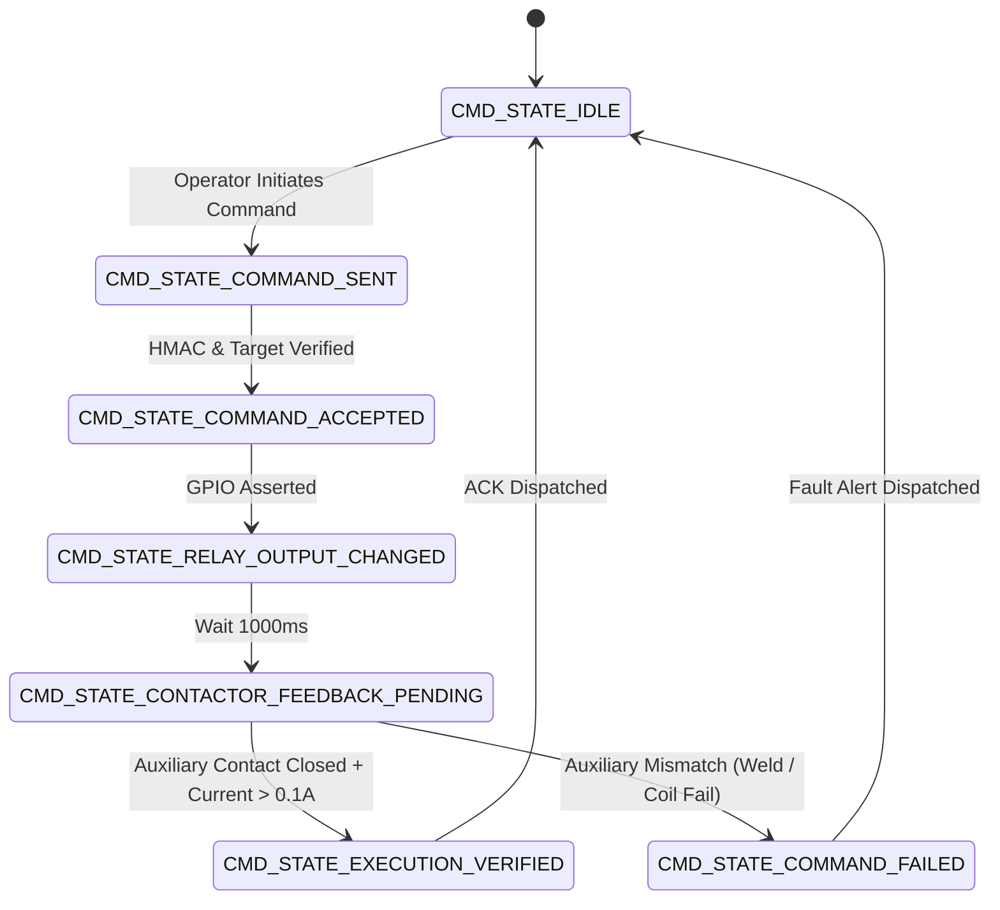

# 11 — MSCB Smart Pole Automation System: Feeder Control & Electrical Actuation

**Document ID**: MSCB-DOC-11  
**Classification**: Electrical Automation & Actuation Safety  
**Feeders Managed**: 6 Independent Three-Phase Feeders per Pole (300 Network-Wide)  
**Date**: November 2026  
**Status**: Authoritative Handover Documentation  

---

## 1. Five-Stage Command Execution State Machine

In industrial switchgear automation, an unverified command (e.g. driving a relay output without feedback) can lead to unobserved contact welds, coil burnouts, or fire hazards. The MSCB Smart Pole architecture mandates a strict **Five-Stage Verification Lifecycle** for every feeder command:

```
┌─────────────────────────────────────────────────────────────────────────────┐
│                    FIVE-STAGE FEEDER EXECUTION LIFECYCLE                    │
├───────┬─────────────────────────────┬───────────────────────────────────────┤
│ Stage │ Execution State             │ Criteria / Electrical Verification    │
├───────┼─────────────────────────────┼───────────────────────────────────────┤
│ 1     │ COMMAND_SENT                │ Gateway dispatches authenticated LoRa │
│       │                             │ packet with sequence number & nonce.  │
├───────┼─────────────────────────────┼───────────────────────────────────────┤
│ 2     │ COMMAND_ACCEPTED            │ Field Pole decodes frame, verifies    │
│       │                             │ HMAC tag, validates target feeder ID, │
│       │                             │ and confirms safety interlocks clear. │
├───────┼─────────────────────────────┼───────────────────────────────────────┤
│ 3     │ RELAY_OUTPUT_CHANGED        │ Microcontroller drives optocoupler    │
│       │                             │ GPIO pin (Active-LOW transition).     │
├───────┼─────────────────────────────┼───────────────────────────────────────┤
│ 4     │ CONTACTOR_FEEDBACK_CONFIRMED│ Contactor auxiliary dry contact       │
│       │                             │ closes/opens; debounced over 250 ms   │
│       │                             │ (5 consecutive 50ms samples).         │
├───────┼─────────────────────────────┼───────────────────────────────────────┤
│ 5     │ ELECTRICAL_STATE_VERIFIED   │ ADS131M08 True-RMS metrology confirms │
│       │                             │ current is flowing ($I > 0.1\text{ A}$)│
│       │                             │ for ON, or zero current for OFF.      │
└───────┴─────────────────────────────┴───────────────────────────────────────┘
```



---

## 2. Electrical Protection & Interlock Architecture

### 2.1 Overcurrent Fast-Trip Interlock
Each feeder channel continuously monitors load current against the configured overcurrent threshold (`CONF_OVERCURRENT_THRESH_A = 25.0f`). If current exceeds the threshold continuously for 3.0 seconds (`CONF_OVERCURRENT_DUR_MS = 3000`):
1. The pole firmware immediately de-energizes the corresponding relay coil locally without waiting for Gateway authorization.
2. The feeder status transitions to `FEEDER_TRIPPED_OVERCURRENT`.
3. An emergency high-priority LoRa alert (`ALERT`) is broadcast to the Gateway.
4. The relay remains locked out in hardware until an administrator manually resets the fault via Telegram (`CMD:RESET_FAULT`).

### 2.2 MCB Auxiliary Trip Detection
Each feeder's manual Miniature Circuit Breaker (MCB) is fitted with an auxiliary dry contact wired to the ESP32:
- Contact is sampled every 50 ms.
- If the contact opens for $\ge 5$ consecutive samples (250 ms debounce), an MCB Trip event is flagged.
- The firmware immediately opens the feeder pilot relay to prevent unexpected reclosing when the manual breaker is reset.

### 2.3 Contactor Abnormality Classifications
The system detects four dangerous electromechanical failure modes:
1. **FEEDBACK_QUALITY_WELDED**: The relay output was commanded OFF, but the auxiliary contact remains CLOSED and current is still flowing. (Critical Safety Alert).
2. **FEEDBACK_QUALITY_COIL_FAIL**: The relay output was commanded ON, but the auxiliary contact failed to close within 1,000 ms. (Coil burnout / mechanical jam).
3. **FEEDBACK_QUALITY_UNEXPECTED_OPEN**: Contactor dropped open while relay was energized (vibration, power dip).
4. **FEEDBACK_QUALITY_UNEXPECTED_CLOSE**: Contactor closed without microcontroller activation (manual override / contact welding).

---

## 3. Group Switching & Inrush Surge Staggering

When switching multiple feeders across a pole or issuing group commands across the 50-node network:
- **Inrush Current Hazard**: Switching 6 three-phase inductive motor loads or LED street light banks simultaneously causes severe transformer voltage sag and trips upstream distribution breakers.
- **Staggering Rule**: The firmware enforces a mandatory **500 ms staggering interval** (`DEFAULT_GROUP_STAGGER_MS = 500`) between successive feeder actuations:
  $$t_{actuation}(k) = t_0 + (k \times 500\text{ ms}) \quad \text{for } k = 0, 1, \dots, 5$$
- During emergency shutoff (`ALL_FEEDERS_OFF`), all relays are de-energized simultaneously in 0 ms to ensure personnel safety.

---

## 4. Feeder Deactivation vs. Deletion

The system maintains an operational distinction between deactivating a feeder and removing it:

| Operational State | Electrical Relay State | Telegram UI Status | Telemetry Monitoring | Re-activation Method |
| :--- | :---: | :---: | :---: | :--- |
| **Active** | Controllable (ON/OFF) | `🟢 Feeder Active` | Full (18 Current Chs) | Normal Operation |
| **Deactivated** | Permanently Locked OFF | `⛔ Deactivated (Maintenance)` | Voltage & Offsets Only | Admin `/feeder activate` |
| **Removed** | De-provisioned | Hidden from Dashboard | Excluded from Telemetry| Re-commissioning required |

- **Deactivation Use Case**: Seasonal irrigation feeders (e.g. pumps offline during harvest) or street lights undergoing physical cable maintenance. Deactivated feeders reject all scheduled or group switching commands.

---

## 5. R3 Real Hardware Feeder Actuation Mapping & Pin Integrity

The Field Pole (ESP32-WROOM-32) utilizes an authoritative, single source of truth pin map defined in `PoleBoardPins.h` (`POLE_FEEDER_RELAY_PINS`). Duplicate arrays (such as legacy `SAFE_RELAY_PINS`) have been excised.

### 5.1 Relay Output Hardware Pin Table
| Feeder Channel | Physical Pin Header Position | Board Silkscreen Label | ESP32 GPIO | Active Electrical Level | Output Type |
| :--- | :---: | :---: | :---: | :---: | :--- |
| **Feeder 1** | **24** | **D26** | **GPIO 26** | LOW (0V) | Optocoupled Relay Pilot Driver |
| **Feeder 2** | **23** | **D25** | **GPIO 25** | LOW (0V) | Optocoupled Relay Pilot Driver |
| **Feeder 3** | **25** | **D27** | **GPIO 27** | LOW (0V) | Optocoupled Relay Pilot Driver |
| **Feeder 4** | **6** | **RX2** | **GPIO 16** | LOW (0V) | Optocoupled Relay Pilot Driver |
| **Feeder 5** | **7** | **TX2** | **GPIO 17** | LOW (0V) | Optocoupled Relay Pilot Driver |
| **Feeder 6** | **21** | **D32** | **GPIO 32** | LOW (0V) | Optocoupled Relay Pilot Driver |

> [!IMPORTANT]
> **Physical Position 24 vs Silicon GPIO 24**: Feeder 1 is connected to Physical Header Pin 24, which maps to ESP32 silicon **GPIO 26** (Board silkscreen **D26**). Silicon GPIO 24 does not exist on classic ESP32 chips and must NEVER be referenced in firmware.

---

## 6. Centralized Actuation Safety & Isolated Low-Voltage Bench Profile

1. **Production Relay Lockout**: `MSCB_RELAYS_LOCKED_DISABLED 1` in `MSCBShared/BuildConfig.h` permanently blocks production relay activation until physical switchgear commissioning is formally certified.
2. **Dedicated Bench Test Profile**: `MSCB_BENCH_TEST_PROFILE_ENABLED` (default `0`) provides an isolated test environment. It requires physical compile-time activation and local commissioning override. Remote Telegram commands CANNOT bypass or enable bench mode.
3. **Mains Testing Ban**: Bench testing must exclusively use an isolated current-limited low-voltage DC source with loads disconnected from 230V/415V mains.
4. **Boot Diagnostics**: `PoleActuators::validateStartupState()` reads back all 6 GPIO levels. If any channel is active at boot, the driver halts into `ACTUATOR_STATE_FAULT`.

---

## 7. Multi-Feeder Stagger & ACK Aggregation (Mask 0x3F)

For per-pole ALL commands (`ALL ON` / `ALL OFF`):
1. **Inrush Protection**: Feeders F1 through F6 are sequentially switched with a 500 ms inter-feeder delay.
2. **Expected Response Mask (`0x3F`)**: The Gateway command tracker waits for terminal responses across all 6 bits (`0x01 | 0x02 | 0x04 | 0x08 | 0x10 | 0x20 = 0x3F`).
3. **Truthful Reporting**: The Gateway marks the command completed ONLY when all 6 feeders confirm their state. If any feeder fails or times out, the result is reported as partial failure with exact per-feeder details.

---

## 8. Bounded Network-Wide Command Queue

Network-wide operations (up to 50 poles, 300 feeders) are governed by `GwNetworkQueue`:
1. **Rate Limiting**: Dispatches at most 3 in-flight commands simultaneously to avoid LoRa channel saturation and tracker overflow.
2. **State Machine**: Tracks tasks through `QUEUED -> DISPATCHED -> CONFIRMED / PARTIAL / FAILED / TIMEOUT`.
3. **Comprehensive Summary**: Reports total targeted poles, fully confirmed poles, partial poles, and failed poles back to Telegram.

